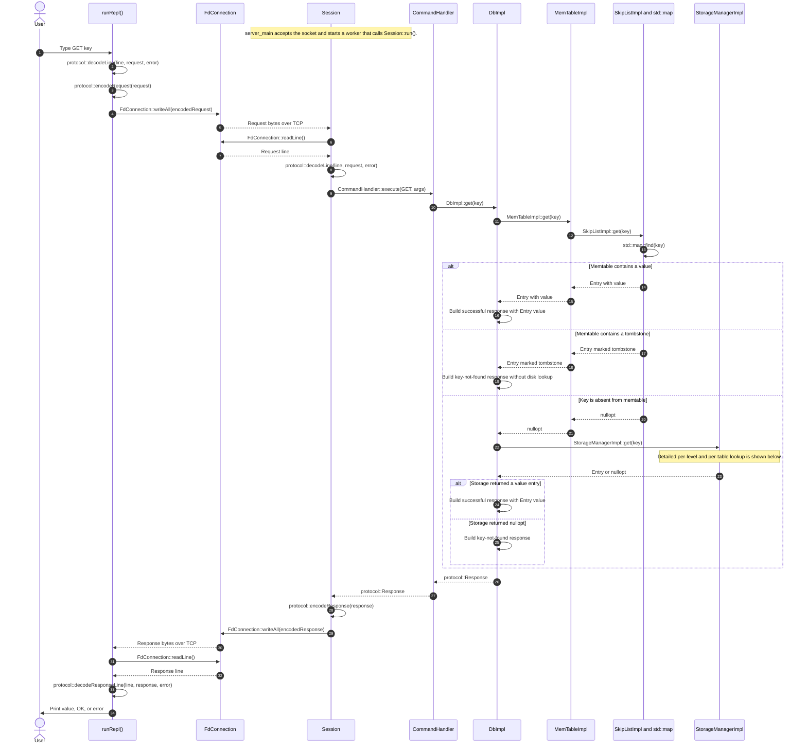
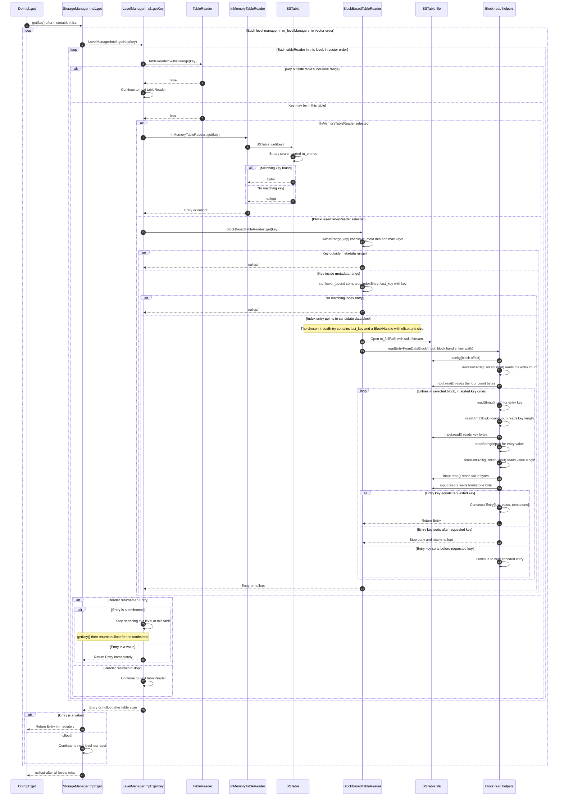

# TinyKV read path

The first diagram follows a `GET` from the CLI to the database and back. The second expands the storage lookup beneath `StorageManagerImpl::get()`, including what each table reader does internally. `SkipListImpl` is backed by `std::map` despite its name.

## Request and response path

## Storage and table-reader lookup

For block-based tables, `BlockBasedTableReader` loads the footer, filter, index, and metadata when its reader is opened. A point lookup uses the metadata range and index; the current `get()` does not consult the loaded filter. It opens the table file and reads only the candidate data block. For in-memory tables, `InMemoryTableReader::get()` delegates to `SSTable::get()`, which binary-searches entries materialized when the reader was opened.

`StorageManagerImpl::initLevels()` is called lazily by `StorageManagerImpl::write()`, not by `get()` or server startup. Before a write initializes the level managers, a memtable miss may not search existing SSTables on disk. There is also a tombstone limitation: `LevelManagerImpl::getKey()` stops at a tombstone but returns `nullopt`, so `StorageManagerImpl::get()` cannot distinguish it from a miss and may continue into a deeper level. A tombstone in the memtable does stop the lookup in `DbImpl::get()`.
