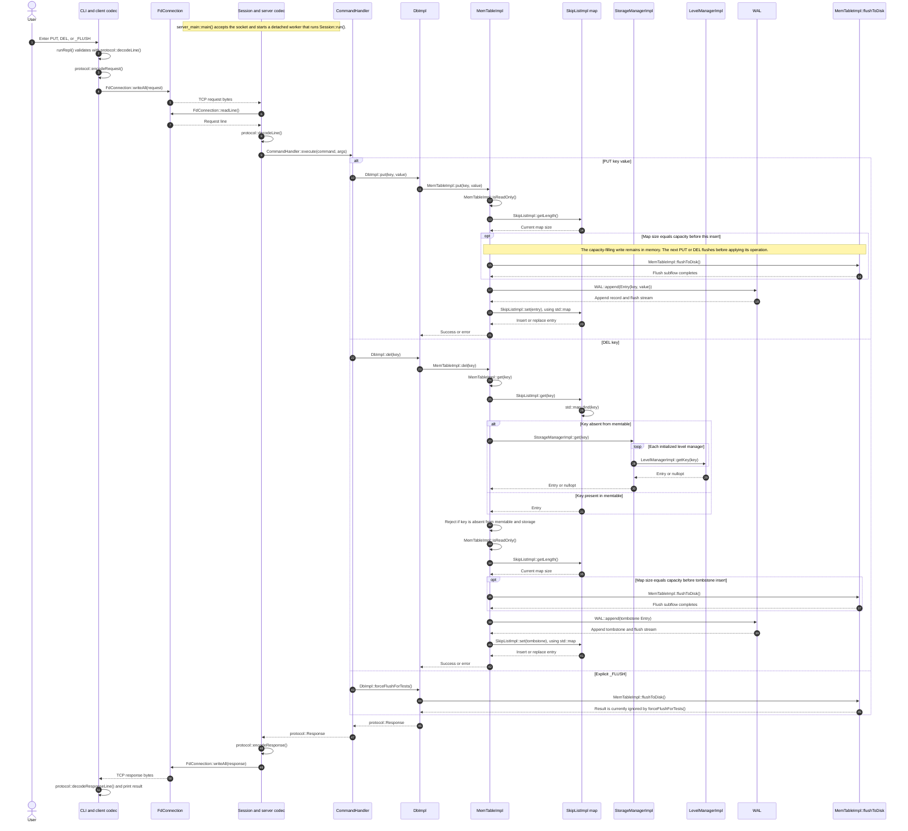
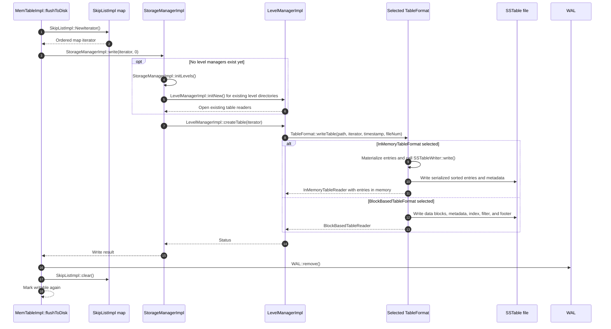

# TinyKV write path

These sequence diagrams trace `PUT`, `DEL`, and flush from the client through the storage engine. `SkipListImpl` is currently backed by `std::map` despite its name.

## Request and memtable update

## Flush subflow

The current capacity check uses `map.size() == capacity` before inserting the incoming operation. A flush therefore happens on the operation after the map reaches capacity. An explicit flush assumes a non-empty memtable: table formats reject empty tables, and `DbImpl::forceFlushForTests()` currently ignores the error returned by `MemTableImpl::flushToDisk()`. The DB write methods currently do not acquire a mutex.
